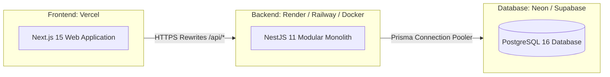

# AI Detector

> Production-grade, privacy-first AI text analysis application and modular monolith built with Next.js 15, NestJS 11, Prisma ORM, and PostgreSQL.

[](https://github.com/Vikash7t/ai-detector/actions/workflows/ci.yml)
[](LICENSE)
[]()
[]()

---

## 📌 Overview

**AI Detector** is a full-stack SaaS platform designed for high-precision AI text detection. It combines commercial detection capabilities (Sapling AI API) with sentence-level statistical scoring, privacy-preserving ephemeral guest scans, and persistent scan management for registered users.

### Architectural Principles
- **Privacy-First (Zero-Retention):** Guest scans are strictly ephemeral (in-memory processing only; submitted text is never stored in the database).
- **Concurrency-Safe Quotas:** Lock-free, atomic two-phase reservations prevent race conditions and over-allocation.
- **Provider Normalization:** Detection responses map Unicode code-point offsets to original text indices with fallback substring alignment.
- **Network Ingress Hardening:** Hardened Express `trust proxy` configuration with verified Cloudflare and RFC 1918 CIDR whitelists to prevent IP spoofing.
- **Observability:** Request-scoped correlation IDs (`X-Correlation-ID`) and structured metadata logging with strict PII/text redaction.

---

## 🏗️ Monorepo Architecture

Managed via `pnpm` workspaces:

```
ai-detector/
├── .github/
│   └── workflows/
│       └── ci.yml              # Automated GitHub Actions CI/CD pipeline
│
├── apps/
│   ├── api/                    # NestJS 11 modular monolith REST backend
│   │   ├── prisma/             # Prisma schema & PostgreSQL migrations
│   │   └── src/
│   │       ├── auth/           # Better Auth integration & session guards
│   │       ├── common/         # Correlation ID & structured request logging middleware
│   │       ├── config/         # App configuration & trusted proxy CIDRs
│   │       ├── detection/      # Provider abstraction & Sapling client
│   │       ├── health/         # System health check endpoints
│   │       ├── prisma/         # Global Prisma database service
│   │       ├── scan/           # Scan lifecycle controller & service
│   │       ├── usage/          # Keyed HMAC rate limits & 60s crash recovery cron
│   │       └── user/           # User profile & account endpoints
│   │
│   └── web/                    # Next.js 15 App Router web client
│       ├── public/             # Static web assets
│       └── src/
│           ├── app/            # App router pages (/, /auth, /history)
│           ├── components/     # UI components (Scanner, Heatmap, HistoryTable, Modal)
│           └── lib/            # Better Auth React client & Unicode text counters
│
├── packages/
│   └── shared-types/           # Common TypeScript DTOs, contracts, and enums
│       └── src/
│           ├── detection.ts    # Provider request/response interfaces
│           ├── scan.ts         # Scan DTOs, status enums & sentence models
│           └── usage.ts        # Quota and rate-limiting schemas
│
├── .env.example                # Canonical environment template
├── pnpm-workspace.yaml         # pnpm workspace definition
└── tsconfig.base.json          # Shared strict TypeScript base config
```

---

## 🚀 Key Features

| Feature | Details |
|---|---|
| **Text Detection** | High-accuracy detection via Sapling AI with `zero_retention: true`. |
| **Sentence Heatmap** | Sentence-by-sentence confidence highlighting (Red $\ge 0.80$, Yellow $0.50$–$0.79$, Clear $< 0.50$). |
| **Ephemeral Guest Scans** | Anonymous scans processed entirely in-memory; 0 text bytes persisted. |
| **User Scan History** | Registered users can review, filter, and permanently cascade-delete scans. |
| **Character-Based Quotas** | Aligned with Sapling API tiers (15,000 char/month user allowance; 25,000 char/day global guest circuit breaker). |
| **Crash Recovery** | Scheduled reconciliation rolls back orphaned `RESERVED` scans after 90 seconds. |
| **Anti-Spoofing** | Extracts client IPs strictly from socket addresses or verified proxy CIDRs. |
| **Observability** | Request correlation tracing with `X-Correlation-ID` header injection. |

---

## 🛠️ Tech Stack

- **Frontend:** Next.js 15 (React 19), Tailwind CSS, TanStack Query, Lucide Icons.
- **Backend:** NestJS 11, Express, Class Validator, `@nestjs/schedule`.
- **Database & Auth:** PostgreSQL, Prisma ORM, Better Auth.
- **Detection Engine:** Sapling AI Detection API (`https://api.sapling.ai/api/v1/aidetect`).
- **Tooling & CI:** pnpm 12, TypeScript 5.7, Jest, GitHub Actions.

---

## ⚡ Getting Started

### 1. Prerequisites
- **Node.js:** `>= 20.0.0`
- **pnpm:** `>= 9.0.0` (Recommended: `10.x` or `12.x`)
- **PostgreSQL:** `>= 15.0`

### 2. Installation
Clone the repository and install dependencies:
```bash
git clone git@github-personal:Vikash7t/ai-detector.git
cd ai-detector
pnpm install
```

### 3. Environment Setup
Copy `.env.example` to `.env`:
```bash
cp .env.example .env
cp .env.example apps/api/.env
```

Configure your environment variables:
- `DATABASE_URL`: PostgreSQL connection string.
- `BETTER_AUTH_SECRET`: Secret key (min 32 chars) for authentication tokens.
- `SAPLING_API_KEY`: Your Sapling API key (leave dummy in dev for automatic deterministic mock).
- `SERVER_PEPPER_KEY`: Server-side secret pepper for keyed HMAC guest rate limiting.

### 4. Database Setup & Prisma Generation
Generate Prisma Client:
```bash
pnpm --filter api run prisma:generate
```

Push or run migrations against your PostgreSQL instance:
```bash
pnpm --filter api run prisma:migrate
```

### 5. Running Development Servers
Start both the Next.js frontend and NestJS API in parallel:
```bash
pnpm dev
```

Or run each service individually:
```bash
# Start NestJS backend (http://localhost:4000)
pnpm dev:api

# Start Next.js frontend (http://localhost:3000)
pnpm dev:web
```

---

## 🧪 Quality Gates & CI Pipeline

The project is governed by automated quality gates running in GitHub Actions on every pull request and push to `main`:

| Command | Action |
|---|---|
| `pnpm --recursive run typecheck` | Validates TypeScript types across the monorepo with 0 errors. |
| `pnpm --filter api test` | Executes Jest automated test suite (30 unit & integration tests). |
| `pnpm build` | Compiles all packages and applications (`shared-types`, `api`, `web`). |
| `pnpm dev` | Starts development servers in parallel. |

---

## 🌐 Production Deployment Guide



1. **Backend (Render / Railway / Container):**
   - Deploy Dockerfile or Node.js environment pointing to `apps/api`.
   - Set environment variables (`DATABASE_URL`, `BETTER_AUTH_SECRET`, `SAPLING_API_KEY`, etc.).
   - Start command: `node apps/api/dist/main.js`.
2. **Frontend (Vercel):**
   - Import root monorepo, set Root Directory to `apps/web`.
   - Set `API_INTERNAL_URL` environment variable pointing to your deployed backend URL.

---

## 📄 License

This project is licensed under the [MIT License](LICENSE).
